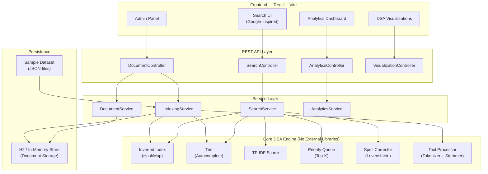
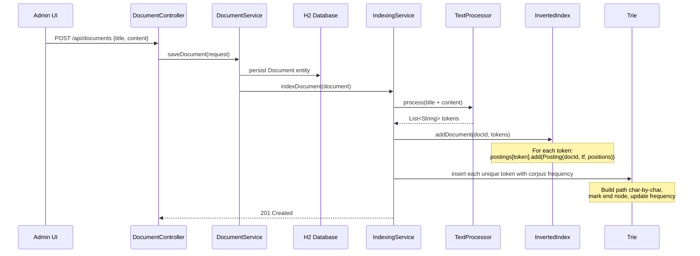
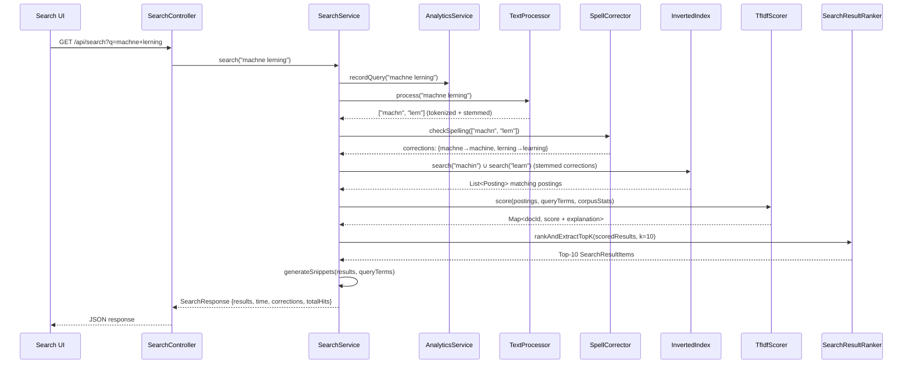
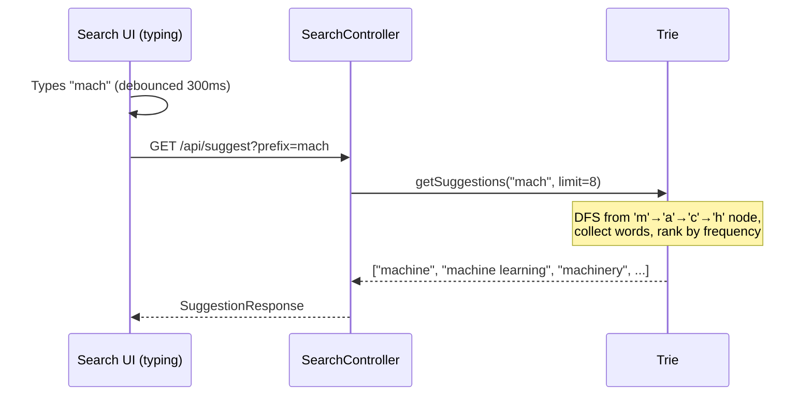

# DSA-Based Search Engine Simulator — Implementation Plan

A portfolio-grade search engine simulator that demonstrates mastery of core Data Structures & Algorithms through a polished, full-stack application. Every search operation — indexing, autocomplete, ranking, and spell correction — is powered by hand-written DSA implementations, **not** external search libraries.

---

## 1. Architecture Overview



### Key Architectural Decisions

| Decision | Choice | Rationale |
|----------|--------|-----------|
| Backend framework | Spring Boot 3.4.x + Java 21 | Industry standard, good for portfolio |
| Build tool | Maven | Widely understood, stable ecosystem |
| Frontend framework | React 18 + Vite | Fast dev server, modern tooling |
| Database | H2 (embedded) | Zero setup, focus stays on DSA |
| Search library | **None** — hand-written | Core requirement: demonstrate DSA skill |
| API style | REST with JSON | Simple, well-understood |
| Styling | Vanilla CSS + CSS variables | Full control, no framework overhead |
| Monorepo | Single Git repo with `/backend` + `/frontend` | Simpler portfolio structure |

---

## 2. Complete Folder Structure

```
SearchEngineSimulator/
├── README.md
├── ALGORITHMS.md                          # Complexity docs for all DSA
├── .gitignore
│
├── backend/
│   ├── pom.xml
│   ├── src/
│   │   ├── main/
│   │   │   ├── java/com/searchengine/
│   │   │   │   ├── SearchEngineApplication.java
│   │   │   │   │
│   │   │   │   ├── config/
│   │   │   │   │   ├── CorsConfig.java             # CORS for React dev server
│   │   │   │   │   └── DataLoaderConfig.java        # Load sample dataset on startup
│   │   │   │   │
│   │   │   │   ├── controller/
│   │   │   │   │   ├── SearchController.java        # /api/search, /api/suggest, /api/spellcheck
│   │   │   │   │   ├── DocumentController.java      # /api/documents CRUD
│   │   │   │   │   ├── AnalyticsController.java     # /api/analytics
│   │   │   │   │   └── VisualizationController.java # /api/visualize (trie/index state)
│   │   │   │   │
│   │   │   │   ├── service/
│   │   │   │   │   ├── SearchService.java           # Orchestrates search pipeline
│   │   │   │   │   ├── DocumentService.java         # Document CRUD operations
│   │   │   │   │   ├── IndexingService.java         # Builds index + trie from documents
│   │   │   │   │   └── AnalyticsService.java        # Tracks and reports search analytics
│   │   │   │   │
│   │   │   │   ├── dsa/                             # ★ CORE DSA — INTERVIEW-READY ★
│   │   │   │   │   ├── index/
│   │   │   │   │   │   ├── InvertedIndex.java       # HashMap<String, List<Posting>>
│   │   │   │   │   │   └── Posting.java             # (docId, termFrequency, positions[])
│   │   │   │   │   │
│   │   │   │   │   ├── trie/
│   │   │   │   │   │   ├── Trie.java                # Insert, search, prefix suggestions
│   │   │   │   │   │   └── TrieNode.java            # children map, isEnd, weight/frequency
│   │   │   │   │   │
│   │   │   │   │   ├── ranking/
│   │   │   │   │   │   ├── TfIdfScorer.java         # TF, IDF, combined score calculation
│   │   │   │   │   │   └── SearchResultRanker.java  # PriorityQueue-based top-K extraction
│   │   │   │   │   │
│   │   │   │   │   ├── spellcheck/
│   │   │   │   │   │   ├── LevenshteinDistance.java  # Edit distance DP algorithm
│   │   │   │   │   │   └── SpellCorrector.java       # Suggests corrections using dictionary
│   │   │   │   │   │
│   │   │   │   │   └── text/
│   │   │   │   │       ├── TextProcessor.java        # Orchestrates full text pipeline
│   │   │   │   │       ├── Tokenizer.java            # Split text into tokens
│   │   │   │   │       ├── StopWordFilter.java       # Remove common words
│   │   │   │   │       └── PorterStemmer.java        # Basic suffix-stripping stemmer
│   │   │   │   │
│   │   │   │   ├── model/
│   │   │   │   │   ├── Document.java                # JPA entity
│   │   │   │   │   └── SearchQuery.java             # JPA entity for analytics
│   │   │   │   │
│   │   │   │   ├── dto/
│   │   │   │   │   ├── SearchRequest.java           # Query string, page, size
│   │   │   │   │   ├── SearchResponse.java          # Results, time, suggestions, corrections
│   │   │   │   │   ├── SearchResultItem.java        # Title, snippet, score, explanation
│   │   │   │   │   ├── DocumentRequest.java         # Title, content, url, category
│   │   │   │   │   ├── SuggestionResponse.java      # Autocomplete suggestions
│   │   │   │   │   ├── SpellCheckResponse.java      # Corrected query + alternatives
│   │   │   │   │   ├── AnalyticsResponse.java       # Search stats, trends
│   │   │   │   │   └── TrieVisualizationDTO.java    # Trie structure for frontend rendering
│   │   │   │   │
│   │   │   │   ├── repository/
│   │   │   │   │   ├── DocumentRepository.java      # Spring Data JPA
│   │   │   │   │   └── SearchQueryRepository.java   # Spring Data JPA
│   │   │   │   │
│   │   │   │   └── exception/
│   │   │   │       ├── GlobalExceptionHandler.java   # @ControllerAdvice
│   │   │   │       ├── DocumentNotFoundException.java
│   │   │   │       └── IndexNotReadyException.java
│   │   │   │
│   │   │   └── resources/
│   │   │       ├── application.properties
│   │   │       ├── application-dev.properties
│   │   │       ├── stopwords.txt                     # English stop words list
│   │   │       └── data/
│   │   │           └── sample-documents.json         # 50+ sample documents
│   │   │
│   │   └── test/
│   │       └── java/com/searchengine/
│   │           ├── dsa/
│   │           │   ├── InvertedIndexTest.java
│   │           │   ├── TrieTest.java
│   │           │   ├── TfIdfScorerTest.java
│   │           │   ├── SearchResultRankerTest.java
│   │           │   ├── LevenshteinDistanceTest.java
│   │           │   ├── SpellCorrectorTest.java
│   │           │   └── TextProcessorTest.java
│   │           ├── service/
│   │           │   ├── SearchServiceTest.java
│   │           │   └── IndexingServiceTest.java
│   │           └── controller/
│   │               ├── SearchControllerTest.java
│   │               └── DocumentControllerTest.java
│   │
│   └── target/                                       # Maven build output (gitignored)
│
├── frontend/
│   ├── index.html
│   ├── package.json
│   ├── vite.config.js
│   ├── public/
│   │   └── favicon.svg
│   └── src/
│       ├── main.jsx
│       ├── App.jsx
│       ├── App.css                                   # Global styles + design system
│       │
│       ├── components/
│       │   ├── SearchBar/
│       │   │   ├── SearchBar.jsx                     # Main search input
│       │   │   ├── SearchBar.css
│       │   │   └── Suggestions.jsx                   # Autocomplete dropdown
│       │   ├── SearchResults/
│       │   │   ├── SearchResults.jsx                 # Results list container
│       │   │   ├── SearchResults.css
│       │   │   ├── ResultCard.jsx                    # Individual result with snippet
│       │   │   └── ScoreExplanation.jsx              # TF-IDF score breakdown
│       │   ├── SpellCorrection/
│       │   │   ├── SpellCorrection.jsx               # "Did you mean...?" banner
│       │   │   └── SpellCorrection.css
│       │   ├── Analytics/
│       │   │   ├── AnalyticsDashboard.jsx            # Stats overview
│       │   │   ├── AnalyticsDashboard.css
│       │   │   ├── TrendingKeywords.jsx
│       │   │   └── SearchHistory.jsx
│       │   ├── Visualization/
│       │   │   ├── TrieVisualizer.jsx                # Interactive trie tree
│       │   │   ├── TrieVisualizer.css
│       │   │   └── IndexVisualizer.jsx               # Inverted index table view
│       │   ├── Admin/
│       │   │   ├── AdminPanel.jsx                    # Add/manage documents
│       │   │   ├── AdminPanel.css
│       │   │   └── DocumentForm.jsx                  # Document input form
│       │   └── common/
│       │       ├── Header.jsx
│       │       ├── Header.css
│       │       ├── Footer.jsx
│       │       ├── Footer.css
│       │       ├── LoadingSpinner.jsx
│       │       └── ErrorBoundary.jsx
│       │
│       ├── hooks/
│       │   ├── useSearch.js                          # Search + debounced suggestions
│       │   ├── useAnalytics.js
│       │   └── useDebounce.js
│       │
│       ├── services/
│       │   └── api.js                                # Axios/fetch wrapper for all endpoints
│       │
│       ├── pages/
│       │   ├── HomePage.jsx                          # Landing — big search bar
│       │   ├── HomePage.css
│       │   ├── ResultsPage.jsx                       # Search results view
│       │   ├── ResultsPage.css
│       │   ├── AdminPage.jsx                         # Admin interface
│       │   ├── AdminPage.css
│       │   ├── VisualizationPage.jsx                 # DSA visualizations
│       │   ├── VisualizationPage.css
│       │   ├── AnalyticsPage.jsx                     # Analytics dashboard
│       │   └── AnalyticsPage.css
│       │
│       └── utils/
│           ├── highlighter.js                        # Highlight keywords in snippets
│           └── formatters.js                         # Time, score formatting
│
└── docs/
    ├── api-reference.md                              # REST API documentation
    └── screenshots/                                  # For README
```

---

## 3. DSA Components — Detailed Design

Each DSA class is **self-contained** and **interview-explainable**. The `dsa/` package contains zero Spring dependencies — pure Java algorithms.

### 3.1 Inverted Index (`dsa/index/`)

| Aspect | Detail |
|--------|--------|
| **Data Structure** | `HashMap<String, List<Posting>>` |
| **Posting** | Record containing `docId`, `termFrequency`, `List<Integer> positions` |
| **Operations** | `addDocument(docId, tokens)`, `search(term) → List<Posting>`, `searchMultiple(terms) → intersection/union` |
| **Time Complexity** | Insert: O(n) per document, Lookup: O(1) average per term |
| **Space Complexity** | O(T × D) where T = unique terms, D = avg docs per term |

### 3.2 Trie (`dsa/trie/`)

| Aspect | Detail |
|--------|--------|
| **Data Structure** | Tree of `TrieNode` with `HashMap<Character, TrieNode> children` |
| **Node Fields** | `children`, `isEndOfWord`, `frequency` (for ranking suggestions) |
| **Operations** | `insert(word, freq)`, `search(word) → boolean`, `getSuggestions(prefix, limit) → List<String>` |
| **Suggestion Strategy** | DFS from prefix node, return top-K by frequency using a min-heap |
| **Time Complexity** | Insert/Search: O(L) where L = word length; Suggestions: O(N) worst case across subtree |

### 3.3 TF-IDF Scorer (`dsa/ranking/`)

| Aspect | Detail |
|--------|--------|
| **TF Formula** | `tf(t,d) = count(t in d) / total_terms(d)` |
| **IDF Formula** | `idf(t) = log(N / df(t))` where N = total docs, df = docs containing t |
| **Combined** | `score(t,d) = tf(t,d) × idf(t)` |
| **Multi-term** | Sum of individual term scores for the document |
| **Time Complexity** | O(Q × R) where Q = query terms, R = result documents |

### 3.4 Search Result Ranker (`dsa/ranking/`)

| Aspect | Detail |
|--------|--------|
| **Data Structure** | `PriorityQueue<SearchResultItem>` (max-heap by score) |
| **Operation** | Insert all scored results → extract top-K |
| **Time Complexity** | Build heap: O(R log R); Extract top-K: O(K log R) |

### 3.5 Spell Corrector (`dsa/spellcheck/`)

| Aspect | Detail |
|--------|--------|
| **Algorithm** | Levenshtein Edit Distance (dynamic programming) |
| **Distance Matrix** | `int[m+1][n+1]` DP table |
| **Operations** | `distance(s1, s2) → int`, `suggest(word, dictionary, maxDistance) → List<String>` |
| **Optimization** | Early termination if min possible distance > threshold; candidates drawn from Trie traversal |
| **Time Complexity** | Distance: O(m × n); Suggestion: O(D × m × n) worst case, optimized with Trie pruning |

### 3.6 Text Processor (`dsa/text/`)

| Component | Detail |
|-----------|--------|
| **Tokenizer** | Regex split on non-alphanumeric, lowercase normalization |
| **StopWordFilter** | HashSet lookup, loaded from `stopwords.txt` (~175 English words) |
| **PorterStemmer** | Classic 5-step suffix stripping (e.g., "running" → "run", "studies" → "studi") |
| **Pipeline** | `process(text) → List<String>`: tokenize → lowercase → remove stops → stem |

---

## 4. Data Flow — End to End

### 4.1 Document Indexing Flow



### 4.2 Search Query Flow



### 4.3 Autocomplete Flow



---

## 5. REST API Design

| Method | Endpoint | Description | Request | Response |
|--------|----------|-------------|---------|----------|
| `GET` | `/api/search` | Full search with ranking | `?q=query&page=0&size=10` | `SearchResponse` |
| `GET` | `/api/suggest` | Autocomplete suggestions | `?prefix=mac&limit=8` | `SuggestionResponse` |
| `GET` | `/api/spellcheck` | Spell correction only | `?q=machne` | `SpellCheckResponse` |
| `POST` | `/api/documents` | Add & index a document | `DocumentRequest` body | `Document` |
| `GET` | `/api/documents` | List all documents | `?page=0&size=20` | Paginated documents |
| `GET` | `/api/documents/{id}` | Get single document | — | `Document` |
| `DELETE` | `/api/documents/{id}` | Remove document & re-index | — | 204 No Content |
| `POST` | `/api/index/rebuild` | Rebuild entire index | — | 200 OK + stats |
| `GET` | `/api/analytics/summary` | Overall search stats | — | `AnalyticsResponse` |
| `GET` | `/api/analytics/trending` | Top trending keywords | `?limit=10` | List of keywords |
| `GET` | `/api/analytics/history` | Recent searches | `?limit=50` | List of queries |
| `GET` | `/api/visualize/trie` | Trie structure as JSON tree | `?prefix=` (optional) | `TrieVisualizationDTO` |
| `GET` | `/api/visualize/index` | Inverted index snapshot | `?term=` (optional) | Index entries |

---

## 6. Frontend Pages & UX Design

### Page Map

| Page | Route | Description |
|------|-------|-------------|
| **Home** | `/` | Google-style centered search bar, logo, clean background |
| **Results** | `/search?q=...` | Results list with snippets, score badges, execution time, spell correction banner |
| **Admin** | `/admin` | Document management — add, view, delete documents; trigger re-index |
| **Visualizations** | `/visualize` | Interactive Trie tree visualization + Inverted Index table |
| **Analytics** | `/analytics` | Dashboard with trending keywords chart, search volume, recent queries |

### Design Language

- **Color Palette**: Dark-mode-first with a deep navy (`#0f172a`) base, electric blue (`#3b82f6`) accent, subtle gradients
- **Typography**: Inter (Google Fonts) — clean, modern, highly readable
- **Cards**: Glassmorphism with `backdrop-filter: blur()`, subtle borders
- **Animations**: Smooth transitions on search bar focus, result card entrance (stagger), loading skeleton states
- **Responsive**: Mobile-first grid, search bar collapses cleanly on small screens

---

## 7. Sample Dataset

50+ documents across diverse topics for meaningful search results:

| Category | Count | Examples |
|----------|-------|---------|
| Technology | 12 | Machine Learning basics, Blockchain explained, Cloud computing guide |
| Science | 10 | Quantum physics intro, DNA structure, Climate change research |
| History | 8 | World War II overview, Ancient civilizations, Space race |
| Programming | 10 | Java collections guide, REST API design, Git workflows |
| Business | 5 | Startup strategies, Digital marketing, Supply chain |
| Health | 5 | Nutrition fundamentals, Exercise science, Mental health |

Each document will have: `id`, `title`, `content` (200–500 words), `url`, `category`, `createdAt`.

---

## 8. Development Phases

### Phase 1 — Project Scaffolding *(~30 min)*
- [ ] Initialize Spring Boot project with Maven (`pom.xml`)
- [ ] Initialize React project with Vite
- [ ] Set up folder structure for both
- [ ] Configure CORS, application properties
- [ ] Verify both servers start independently

### Phase 2 — Core DSA Engine *(~2–3 hours)*
- [ ] `TextProcessor` — tokenizer, stop words, stemmer
- [ ] `InvertedIndex` — build index, single/multi-term lookup
- [ ] `Trie` — insert, search, prefix suggestions
- [ ] `TfIdfScorer` — TF, IDF, combined scoring
- [ ] `SearchResultRanker` — PriorityQueue top-K
- [ ] `LevenshteinDistance` — edit distance DP
- [ ] `SpellCorrector` — dictionary-based suggestions
- [ ] **Unit tests for every DSA class**

### Phase 3 — Backend Services & API *(~1.5 hours)*
- [ ] `Document` entity + JPA repository
- [ ] `DocumentService` — CRUD
- [ ] `IndexingService` — build index from documents
- [ ] `SearchService` — orchestrate search pipeline
- [ ] `AnalyticsService` — track queries
- [ ] REST controllers with proper DTOs
- [ ] Global exception handling
- [ ] Sample dataset loader (`DataLoaderConfig`)
- [ ] API integration tests

### Phase 4 — Frontend Core UI *(~2 hours)*
- [ ] Design system (CSS variables, fonts, base styles)
- [ ] `HomePage` — Google-style search bar
- [ ] `SearchBar` with autocomplete dropdown
- [ ] `ResultsPage` — result cards with highlighted snippets
- [ ] `SpellCorrection` — "Did you mean?" banner
- [ ] Score explanation tooltips
- [ ] Loading states, error handling
- [ ] Responsive layout

### Phase 5 — Admin & Document Management *(~1 hour)*
- [ ] `AdminPage` — document list with delete
- [ ] `DocumentForm` — add new documents
- [ ] Re-index trigger button
- [ ] Confirmation modals

### Phase 6 — Visualizations *(~1.5 hours)*
- [ ] Trie visualization (interactive tree rendered with SVG/Canvas)
- [ ] Inverted Index visualization (searchable table)
- [ ] Visualization API endpoints

### Phase 7 — Analytics Dashboard *(~1 hour)*
- [ ] `AnalyticsPage` — search stats cards
- [ ] Trending keywords bar chart (CSS/SVG, no heavy chart lib)
- [ ] Recent search history table
- [ ] Most searched queries

### Phase 8 — Polish & Documentation *(~1 hour)*
- [ ] `README.md` — project overview, setup instructions, screenshots
- [ ] `ALGORITHMS.md` — complexity analysis for each DSA component
- [ ] API reference docs
- [ ] Final UI polish — animations, transitions, edge cases
- [ ] `.gitignore` for both backend and frontend

---

## 9. Technical Risks & Mitigations

| Risk | Impact | Mitigation |
|------|--------|------------|
| **In-memory index lost on restart** | All search data gone after server restart | Auto-rebuild index from H2 on application startup via `DataLoaderConfig` |
| **Large dataset degrades Trie suggestion speed** | Autocomplete becomes slow | Limit Trie depth, cap suggestions with frequency-weighted min-heap, debounce frontend calls |
| **Spell correction is O(D×m×n) against full dictionary** | Slow for large vocabularies | Use Trie-guided traversal with edit distance pruning (BK-tree-like approach); threshold max distance to 2 |
| **Porter Stemmer edge cases** | Over/under-stemming ("university"→"univers") | Acceptable for portfolio scope; document known limitations in `ALGORITHMS.md` |
| **CORS issues between React dev server and Spring Boot** | Frontend can't reach API | Explicit `CorsConfig.java` allowing `localhost:5173` |
| **Concurrent index modification** | Race conditions during re-index while searching | Use `ReadWriteLock` on the inverted index; rebuild creates a new index then swaps atomically |
| **H2 data limits** | In-memory DB limited by heap | Sufficient for 50–200 documents; document in README |

---

## 10. Suggested Improvements (Future Scope)

These are **not** in the current plan but would strengthen the project further:

- **BK-Tree** for spell correction — O(log n) average instead of O(n) brute force
- **PageRank-style link analysis** if documents reference each other
- **Phrase search** using positional index (already stored in `Posting.positions`)
- **Boolean query support** (AND, OR, NOT operators)
- **Index persistence to disk** using serialization
- **WebSocket** for real-time autocomplete instead of REST polling
- **Docker Compose** for one-command deployment
- **Performance benchmarking** page comparing DSA implementations

---

## 11. Prerequisites — Required Software on Windows

> [!IMPORTANT]
> Ensure all of the following are installed and available on your system `PATH` before we begin.

| Software | Version | Purpose | Verify Command |
|----------|---------|---------|----------------|
| **Java JDK** | 21+ | Backend compilation & runtime | `java -version` |
| **Maven** | 3.9+ | Backend build & dependency management | `mvn -version` |
| **Node.js** | 18+ (LTS recommended) | Frontend runtime | `node -v` |
| **npm** | 9+ (comes with Node) | Frontend package management | `npm -v` |
| **Git** | Latest | Version control | `git --version` |

> [!TIP]
> **Optional but recommended:**
> - VS Code / IntelliJ IDEA for development
> - Postman or similar for API testing
> - A modern browser with DevTools for frontend debugging

---

## Open Questions

> [!IMPORTANT]
> **1. Spring Boot Version**: Spring Boot 3.4.x is EOL. Should I use **3.4.13** (stable, widely documented) or **Spring Boot 4.x** (latest, but newer)? For a portfolio project, 3.4.x is perfectly fine and more widely recognized by interviewers. **Recommendation: 3.4.13.**

> [!IMPORTANT]
> **2. Base Package Name**: I plan to use `com.searchengine` as the Java package. Would you prefer something like `com.yourname.searchengine` or `com.portfolio.searchengine`?

> [!NOTE]
> **3. Trie Visualization Library**: I plan to render the Trie as an SVG tree using pure JavaScript (no D3.js or heavy libraries). This keeps the project lightweight but the visualization will be simpler. Alternatively I can use a small canvas-based approach. Are you okay with SVG, or do you have a preference?

> [!NOTE]
> **4. Chart Library for Analytics**: For the analytics dashboard, I plan to build simple bar charts with pure CSS/SVG. If you'd prefer richer charts, I could use a lightweight library like Chart.js. What's your preference?
